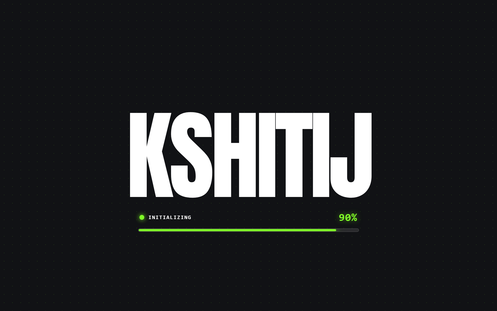
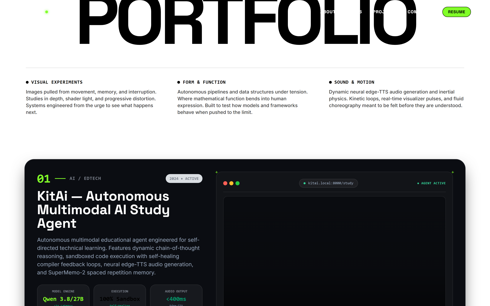
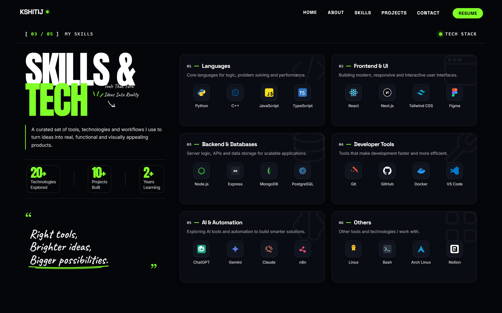
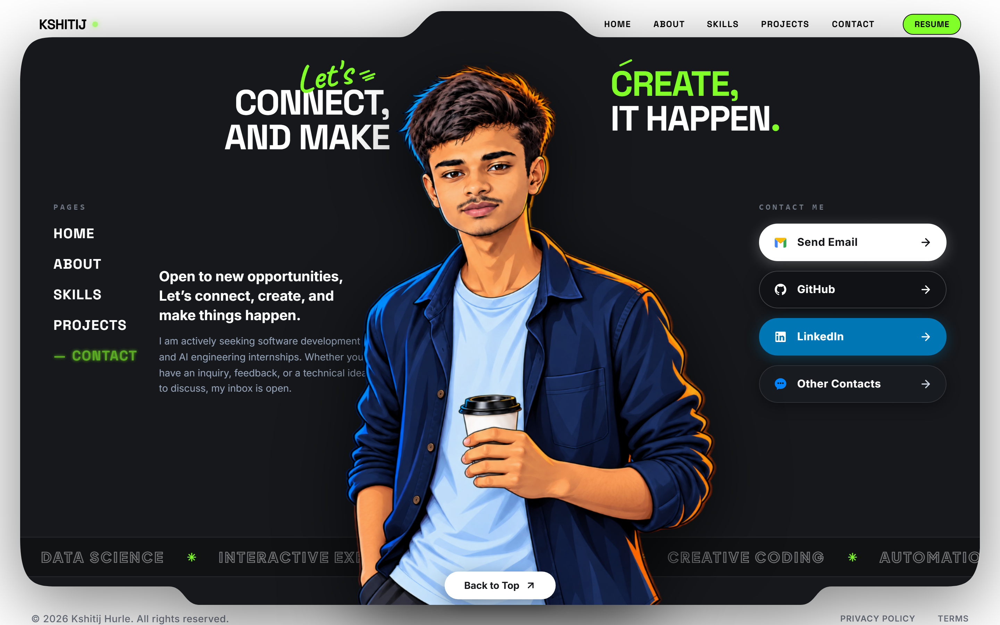

<div align="center">

# ⚡ Kshitij Hurle • Creative Developer & AI Systems Engineer

<p align="center">
  <strong>A high-performance, cinematic personal portfolio combining custom WebGL shaders, kinetic GSAP motion, interactive 3D physics, and algorithmic layout engineering.</strong>
</p>

[](https://kshitijhurle95-prog.github.io/portfolio/)
[](LICENSE)
[](https://greensock.com/gsap/)
[](https://threejs.org/)
[](https://tailwindcss.com/)

---

[🌐 Explore Live Site](https://kshitijhurle95-prog.github.io/portfolio/) • [✨ Features](#-key-features) • [📸 Visual Showcase](#-visual-showcase) • [📐 Architecture](#-architecture--file-tree) • [🛠️ Tech Stack](#️-tech-stack) • [🚀 Quickstart](#-quickstart--local-development)

---

</div>

## 💡 Executive Summary

Most developer portfolios are static grids of cards. **This portfolio was engineered as an immersive, narrative-driven digital experience.** 

It bridges cutting-edge creative front-end engineering with resilient software architecture. Built from the ground up without heavy frameworks, it features a fluid **Lenis smooth-scroll physics engine**, an **interactive 3D WebGL Earth globe**, **custom fragment/vertex shader transitions** (inspired by Curtis.digital and Paul Kalkbrenner), and **dynamic viewport-aware theme synchronization** that transforms typography and cursor states in real time.

---

## 📸 Visual Showcase

<div align="center">

### 🖥️ 1. Hero Landing & Kinetic Typography
*High-contrast hero section with dynamic kinetic text reveals, magnetic physics, and custom interactive cursor tracking.*



<br/><br/>

### 🧩 2. Paul Kalkbrenner Pixel Seam & Curtis.digital Shader Cards
*Scrub-driven pixelated mosaic transition dissolving into featured project showcases with custom GLSL hover displacement.*



<br/><br/>

### 🛠️ 3. Full-Spectrum Technical Skills Matrix
*Segmented technical capability architecture covering Core Engineering, AI Systems, Cloud/DevOps, and Creative UI.*



<br/><br/>

### 📬 4. Sculpted 3D Floating Contact Hub
*Dark sculpted floating card surface with SVG outline dash-offset tracing, live marquee ticker, and direct communication channels.*



</div>

---

## ✨ Key Features

- 🌍 **Interactive 3D WebGL Globe**: Real-time rotating planetary sphere with atmospheric specular maps, city light shaders, and orbital mouse damping powered by Three.js.
- 🎬 **Kinetic Scroll Orchestration**: ScrollTrigger scrub sequences synchronizing multi-stage text pins, progress bars, and directional SVG doodle stroke animators.
- 🟩 **Paul Kalkbrenner Pixel Mosaic**: Procedural canvas grid that dynamically dissolves between light and dark sections via mathematical stagger formulas.
- 🪟 **Curtis.digital GLSL Shaders**: WebGL fragment shaders applying directional wave distortions and edge-band color dispersion to project showcase previews.
- 🎯 **Magnetic & Dual-State Cursor**: Custom cursor that tracks pointer velocity, adapts between dark and light sections, and snaps to interactive touchpoints.
- ⚡ **Zero Framework Overhead**: Hand-tuned vanilla JavaScript, CSS custom properties, and Tailwind utility classes achieving 60 FPS rendering on modern displays.
- 📱 **Adaptive Cross-Device Layout**: Fluid clamp typography and flex/grid responsive compositions across mobile, tablet, and ultra-wide viewports.

---

## 📐 Architecture & File Tree

```bash
Portfolio/
├── index.html               # Semantic HTML5 single-page application structure
├── style.css                # Custom CSS design tokens, keyframes & responsive overrides
├── script.js                # Core controller: GSAP timelines, Lenis, WebGL shaders & interactions
├── three.min.js             # High-performance Three.js 3D runtime library
├── logo.png                 # Brand identity mark & favicon asset
├── favicon.ico              # Browser icon
├── assets/
│   └── screenshots/         # Production visual preview captures
│       ├── hero-preview.png
│       ├── feature-interaction.png
│       ├── skills-showcase.png
│       └── contact-showcase.png
├── src/                     # Optimized visual assets & textures
│   ├── earth_atmos_2048.jpg
│   ├── earth_clouds_1024.png
│   ├── earth_lights_2048.png
│   ├── earth_specular_2048.jpg
│   ├── kitai_preview.png
│   ├── opportunityhub_preview.png
│   ├── nebula_preview.png
│   ├── kshitij_hero_portrait.png
│   └── ...
├── .gitignore               # Strict security & environment exclusions
└── README.md                # Comprehensive documentation
```

---

## 🛠️ Tech Stack

| Domain | Technologies & Libraries | Purpose |
| :--- | :--- | :--- |
| **Markup & Semantics** | HTML5, Semantic Web Components | SEO, accessibility, and high-performance DOM hierarchy |
| **Styling & Design** | CSS3, Tailwind CSS, Custom Variables | Atomic styling, glassmorphism, responsive grids & clamp scales |
| **Motion & Physics** | GSAP 3.12, ScrollTrigger, Lenis Scroll | Momentum-based smooth scrolling, timeline scrubbing, and pins |
| **3D & WebGL** | Three.js r128, Raw GLSL (Vertex & Fragment) | Interactive planetary sphere, atmospheric lighting & texture displacement |
| **Deployment** | GitHub Pages, Git | Zero-cost continuous static deployment via GitHub infrastructure |

---

## 🚀 Quickstart & Local Development

This project runs completely serverless and requires no heavy build step or compilation.

### Prerequisites
- Any modern web browser (Chrome, Firefox, Safari, Edge)
- Git installed on your system
- (Optional) [Node.js](https://nodejs.org/) or Python to spin up a local static server

### 1. Clone the Repository
```bash
git clone https://github.com/kshitijhurle95-prog/portfolio.git
cd portfolio
```

### 2. Run Locally

#### Using Python:
```bash
python -m http.server 5500
```

#### Using Node.js:
```bash
npx serve -l 5500 .
```

#### Using VS Code Live Server:
Right-click `index.html` and click **"Open with Live Server"**.

### 3. Open in Browser
Navigate to `http://localhost:5500` to interact with the live experience.

---

## 🔒 Security & Environment Configuration

| Variable / Secret | Required | Description |
| :--- | :---: | :--- |
| *None* | ❌ | Completely client-side static site architecture. No API keys or private tokens required. |

*All sensitive local development scripts, caches, and system files are strictly excluded via `.gitignore`.*

---

## 🤝 Contributing

Contributions, issues, and feature suggestions are welcome!

1. Fork the Project (`https://github.com/kshitijhurle95-prog/portfolio/fork`)
2. Create your Feature Branch (`git checkout -b feature/AmazingFeature`)
3. Commit your Changes (`git commit -m 'feat: Add some AmazingFeature'`)
4. Push to the Branch (`git push origin feature/AmazingFeature`)
5. Open a Pull Request

---

## 📜 License

Distributed under the **MIT License**. See `LICENSE` for more information.

---

<div align="center">
  <sub>Engineered with precision by <a href="https://github.com/kshitijhurle95-prog"><strong>Kshitij Hurle</strong></a> • 2026</sub>
</div>
